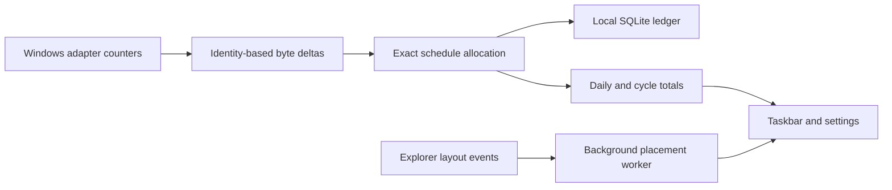

# NetPulse

**Your connection, your data plan, your taskbar.**

NetPulse is a small native Windows network monitor for people whose data plans do not fit a fixed schedule. See live upload/download speeds and today's totals on the taskbar, define your own peak/off-peak hours, and adjust cycle usage to match your provider. Your history stays on your computer.

Created by [Avishka Udara](https://github.com/avishka-Udara). Free software under [GNU GPLv3](LICENSE).

## What makes NetPulse different

- **Your plan, your rules:** overnight peak/off-peak windows, separate allowances, configurable monthly resets, and manual adjustments.
- **Compact visibility:** a transparent, customizable taskbar widget with live speeds and daily totals. A tray fallback keeps tracking available when space cannot be verified.
- **Resets without losing history:** reset today's display or the billing cycle independently while preserving the original traffic ledger.
- **Native and local:** C11, Win32/GDI, and SQLite. No embedded browser, background server, account, telemetry, or cloud storage.
- **Visible capture gaps:** per-app history, daily budgets and forecasts with capture coverage, so unobserved time is distinguishable from recorded zero traffic.
- **Inspectable accounting:** integer byte counters, explicit adapter selection, regression tests, matching source archives, and documented measurement limits.

## Why use NetPulse?

NetPulse helps you answer three everyday questions: **How fast is my connection being used? How much of my plan have I used? Which applications are using the data?** It is useful for capped connections, separate peak/off-peak allowances, background downloads, and checking whether your current usage pace fits your daily budget.

| What you need | Feature to use | Where to find it |
| --- | --- | --- |
| Watch upload/download without opening a window | Live taskbar speeds and today's totals | Taskbar widget |
| Match your provider's schedule | Custom peak/off-peak hours and monthly reset | Data plan |
| Find applications consuming data | Ranked app list, filters, and usage charts | Applications |
| Compare an app's recorded activity | App details and day/month navigation | Applications |
| Start “today” at your plan's boundary | Midnight, peak-start, or custom tracking day | Daily budgets |
| Plan the remaining daily allowance | Daily budgets, forecasts, and contributor cautions | Daily budgets / Applications |
| Receive occasional budget warnings | Optional quiet notifications | Daily budgets |
| Correct the displayed billing-cycle total | Manual usage adjustments | Adjust usage |
| Start a fresh daily display without deleting history | Reset today only | Adjust usage |
| Reduce taskbar work or visual clutter | Tray-only mode | Appearance |
| Keep or limit old app records | Configurable app-history retention | Daily budgets |
| Save a copy of your configuration or history | Settings export and database backup | Manage |

NetPulse measures this computer. It cannot recover traffic from before monitoring began, measure other devices on your router, or guarantee a match with your provider's bill. Budgets and cautions help you decide what to pause or reschedule; they do not block applications or throttle their connections.

## Features and functions

### 1. Live taskbar speeds and daily totals

See download and upload speeds separately, alongside the amount downloaded and uploaded during the current tracking day. This makes an unexpected transfer visible while you work. In **Appearance > Display**, choose **Live speeds only** or **Live speeds and today's totals**. Click the widget or tray icon to open settings; right-click for the menu.

### 2. Daily and billing-cycle overview

**Overview** brings together today's download/upload, current speeds, peak/off-peak cycle usage, remaining plan allowances, and the next reset. Use it to check overall consumption before opening the more detailed app view. **Tracking details** identifies the monitored interfaces, session start, and whether today's display was reset.

### 3. Custom peak and off-peak plans

In **Data plan**, set **Peak starts**, **Peak ends**, and separate allowances. Off-peak automatically covers the remaining hours. Time controls offer half-hour presets and accept a typed `HH:MM`, so a plan starting at `07:15` is supported. Overnight windows work; equal start and end times mean all-day peak. A monthly allowance of `0` means unlimited.

Both uploads and downloads count. Changing peak hours affects future samples; existing records retain their original peak/off-peak classification.

### 4. Monthly reset scheduling

Choose **Monthly reset day** and **Reset time** in **Data plan** to match your billing cycle. Days 29–31 clamp to the last available day in shorter months. The reset starts a new displayed cycle while preserving historical traffic. Changing this schedule changes the date range used to calculate the current cycle.

### 5. Network adapter selection

**Taskbar > Network adapter** defaults to physical adapters with a default route. Choose a specific listed interface when you need to monitor one connection, such as Ethernet instead of Wi-Fi. Adapter identities are tracked so repeated samples are not added twice; independent counter resets are handled per direction.

This choice controls adapter-based totals. The optional app collector has a separate, all-interface scope; selecting an adapter does not filter per-app history.

### 6. Taskbar placement and crowded-layout handling

Choose **Far left**, **Center (nearest free space)**, or **Right (beside system tray)** in **Taskbar**. Adjust **Fine offset (pixels)** or Ctrl-drag the widget for finer positioning. Placement remains subject to detected free space.

When the preferred position is occupied, NetPulse looks for a suitable gap. If space cannot be verified, it falls back to the tray instead of deliberately covering taskbar buttons. Monitoring continues. Integration targets the primary taskbar and depends on Explorer's layout; see the compatibility limits below.

### 7. Theme, transparency, and display size

**Appearance** offers **Follow Windows**, **Light**, and **Dark** themes; **Solid** or **Transparent** widget backgrounds; a configurable width; and adjustable text size. Follow Windows uses the system theme for the widget and the app theme for settings. Larger text can require a wider widget to keep values readable.

### 8. Tray-only mode

Choose **Appearance > Run mode > Tray only (lower overhead)** and save to remove the embedded widget and pause its placement work. Network sampling and history storage continue. This is useful when you prefer an uncluttered taskbar or do not need constantly visible speeds. A fresh tray-only launch avoids initializing the taskbar accessibility worker; libraries loaded earlier in a session may remain in memory until restart.

### 9. Start with Windows

Set **Taskbar > Start with Windows > On - at sign-in** and save to launch NetPulse quietly when you sign in. Windows Startup Apps can independently disable startup. If you move a portable executable, re-enable this setting from its new location.

This starts the normal monitor. It does not automatically enable the elevated app collector; app tracking must be enabled again after each NetPulse restart.

### 10. Individual application usage

In **Applications**, choose **Enable app tracking** to start the optional Windows ETW collector. Windows may ask for administrator consent. The helper records TCP/UDP byte totals by executable; the main UI retains its existing permissions. **Stop app tracking** pauses new capture and preserves saved history.

The ranked list separates download and upload and helps identify background transfers, synchronization tools, or large downloads. It uses executable paths to distinguish applications, caches available local icons, and keeps unresolved processes explicitly grouped. Browser tabs and subprocesses sharing an executable path are grouped together.

App capture covers all interfaces except loopback. LAN transfers and VPN topology can affect the numbers. It does not inspect packet contents or store remote addresses. Earlier adapter totals cannot be assigned to individual applications retroactively.

### 11. Day and month charts

Choose **Day** for hourly bars or **Month** for daily bars, select a date, and move backward or forward with **<** and **>**. The **Traffic** filter selects **All traffic**, **Peak**, or **Off-peak**. Blue represents download; teal represents upload.

Select an application to chart its usage, or choose **All apps** to return to the combined view. Charts follow your configured tracking-day boundary, making it easier to compare activity using your plan's definition of a day.

### 12. App details and daily comparisons

Select an application and choose **App details**, or double-click its row. The dialog shows the selected chart-range total, today's recorded usage so far, the previous full tracking day's usage, and capture coverage for both days. Expand **Technical details** to see the executable path.

The daily comparison uses all traffic. Today is a partial day, while the previous day is a full tracking-day interval; differences in capture coverage also affect the comparison. Use the chart and coverage together before concluding that an app's behavior changed.

### 13. Capture coverage and event-loss indicators

The Applications page shows whether capture is active or paused and what percentage of the selected elapsed range was observed. Gaps remain **unknown usage**, not evidence of zero traffic. History recorded before coverage tracking was introduced has unknown coverage.

Event loss is highlighted and disables rate-based forecasts for the affected capture session. **Forecast > Technical details** shows the continuous-capture start, last heartbeat, and reported lost events/buffers. Coverage describes collector availability, not a guarantee that every billable byte was measured.

### 14. Custom tracking-day start

In **Daily budgets > Start a tracking day**, choose **Midnight (00:00)**, **Peak time starts**, or **Custom time**. The custom time accepts `HH:MM`. For example, a day beginning at `08:00` runs until the following day's `08:00`, rather than resetting at midnight.

This boundary controls today's totals, app-history day views, and daily budgets. The monthly billing reset remains a separate setting.

### 15. Daily budgets, forecasts, and contributor cautions

Set **Daily peak budget (GB)** and **Daily off-peak budget (GB)** in **Daily budgets**. A value of `0` disables that budget. These allowances apply to captured app uploads plus downloads and are separate from the monthly adapter-based plan.

In **Applications > Forecast**, inspect remaining allowance from recorded usage, the recent average speed, the sustainable average until the period ends, and the projected exhaustion time. The forecast uses up to five minutes of recent activity, including idle time within the active band, and needs at least 60 seconds of eligible capture. It projects until the current band ends or the tracking day resets, whichever comes first.

When the budget is at risk or reached, applications contributing at least 5% of the recent rate receive a **High contributor** caution. This helps you decide which download or synchronization job to pause or move to off-peak hours. Forecasts are estimates: changing workloads, other devices, and unobserved traffic can change the actual remaining allowance.

### 16. Optional quiet budget notifications

Choose **Daily budgets > Budget alerts > Quiet notifications** for warnings at 75%, 90%, projected exhaustion, and budget reached. Alerts are off by default. They request no sound, respect Windows quiet time, and work while the settings window is closed, provided app tracking is active.

A 15-minute cooldown applies per time band. Higher-severity alerts supersede lower ones, and each level is claimed once per tracking day and band across restarts. Windows may suppress delivery; suppressed alerts are not retried. Changing a cap does not reset that day's alert claims.

### 17. Manual corrections and usage resets

**Adjust usage** provides three different actions:

| Action | What it changes | What it preserves |
| --- | --- | --- |
| **Apply totals** | Replaces the displayed current-cycle peak/off-peak usage with the entered GB amounts | Raw traffic, today's traffic, and app history |
| **Reset cycle usage** | Sets current-cycle displayed peak/off-peak totals to zero | Historical traffic and today's traffic |
| **Reset today only** | Starts today's displayed download/upload totals from zero | Raw traffic, billing-cycle totals, app history, and daily budgets |

Use **Apply totals** when you want to align the displayed cycle usage with your provider's meter. It records an adjustment; it does not calibrate future measurements. Neither display reset restores a daily app allowance or deletes the underlying history.

### 18. App-history retention and faster long-term views

Choose **Keep all history**, **30 days**, **90 days**, or **365 days** under **Daily budgets > App history retention**. Unlimited retention is the default. A finite choice retains that many completed local tracking days plus the current day.

After saving, retention permanently removes older app traffic and coverage during maintenance. Adapter totals, billing corrections, and daily display resets remain intact. Back up history before reducing retention; choosing unlimited later cannot restore deleted records.

Completed days are cached in small SQLite batches to speed up longer views. Partial-day queries retain minute-level precision, and late arrivals invalidate the affected cache. Freed database pages can be reused; retention does not force an expensive file-shrinking operation during monitoring.

### 19. CSV export, settings backup, and history snapshots

Use **Overview > Export history...** to export the adapter traffic ledger and cycle corrections as CSV. This CSV is not a per-app export, and daily display resets do not rewrite its raw traffic records.

In **Manage**, **Export settings...** saves plan, budget, retention, taskbar, and appearance preferences. **Restore settings...** loads those preferences without changing Windows startup registration or importing traffic history. Restoring a finite retention preference can subsequently prune existing app history, so review the backup's policy before restoring it.

**Back up history...** creates a consistent SQLite snapshot, including committed WAL data and per-app history. **Open data folder** reveals the local files. **Retry saving** retries pending writes after a storage problem has been resolved. For recovery, exit NetPulse and preserve the existing files before replacing the database with a known-good backup.

### 20. Local storage, help, and keyboard navigation

Usage records and settings stay on your computer. There is no account, cloud upload, or monitoring telemetry. The top-right **?** opens Help and About, including the developer link and license information.

Mouse interaction suppresses decorative focus boxes while keyboard navigation retains focus indicators. Settings show validation feedback, indicate unsaved changes, and offer a discard confirmation when closing with pending edits. Use **Save settings** to apply configuration changes.

## New in the 1.4.0 preview

This update adds capture coverage, app icons and detail dialogs, daily comparisons, a detailed forecast view, optional quiet alerts, configurable app-history retention, and cached daily summaries. Background forecast queries are skipped when alerts are off and the analytics pages are closed. Capture buffers are released after tracking stops and pending data is successfully saved.

See [CHANGELOG.md](CHANGELOG.md) for version history and [VALIDATION.md](VALIDATION.md) for test evidence and remaining manual checks. A source update is not automatically a published GitHub release.

## Techniques behind it

| Area | Implementation |
| --- | --- |
| Measurement | Windows IP Helper 64-bit counters, identity-based adapter tracking, per-direction reset handling, and physical/default-route filtering |
| Time allocation | Exact, overflow-safe integer proportional allocation; the remainder stays in the final segment so bytes are conserved |
| Persistence | SQLite WAL, minute buckets, batched transactions, a bounded retry backlog, exact daily summary caches, and incremental totals |
| App insights | Optional ETW helper, heartbeat coverage intervals, recent-rate forecasts, and persistent alert cooldowns |
| Placement | Separate accessibility worker, Explorer-scoped layout events, one-second throttling, 15-second periodic fallback, conservative gap selection |
| Rendering | Reusable widget back buffer, cached fonts, native keyboard-accessible controls, and repositioning only when geometry changes |
| Privacy | Local files only; monitoring needs no outgoing request. Opening the developer link is an explicit user action |



## Install and run

**Version 1.4.0 is an unsigned Windows release candidate.** Windows 10/11 x64 is the current target. macOS/Linux are planned ports, not supported builds.

| Package | Purpose |
| --- | --- |
| `NetPulse-1.4.0-windows-x64-setup.exe` | Per-user installer, Start menu entry, upgrades and uninstall; no administrator rights required |
| `NetPulse-windows-x64.zip` | Portable app; extract before running |
| `NetPulse-1.4.0-source.zip` | Matching GPL source and build scripts |
| `SHA256SUMS.txt` | Package checksums |

Published binaries belong in [GitHub Releases](https://github.com/Avishka-Udara/NetPulse/releases). A source push does not itself create a release. Successful [CI runs](https://github.com/Avishka-Udara/NetPulse/actions) also produce artifacts.

Exit an older running copy before updating. Installer and portable builds normally use the same local data folder. Uninstall preserves usage history. Click the widget or tray icon for settings; right-click for the menu. The top-right **?** opens Help and About.

Enable **Taskbar > Start with Windows > On - at sign-in**, then save, to start quietly. Windows Startup Apps can independently disable registration. Re-enable startup after moving a portable executable.

```powershell
# Separate profile; the parent directory must exist.
.\NetPulse.exe --data-dir "C:\MyProfiles\NetPulse"
# Start quietly.
.\NetPulse.exe --background
# Save pending traffic and exit normally.
.\NetPulse.exe --quit
```

Only one instance runs at a time. A normal second launch opens the existing settings window.

## Current settings reference

These are the shipped defaults for a new profile, not a reading of your personal settings. Existing profiles keep their saved values. Times use Windows local time and daylight-saving rules. Data units are decimal: **1 GB = 1,000,000,000 bytes**; widget K/M/G suffixes mean KB/MB/GB, and `/s` means bytes per second.

| Page / setting | Available values | New-profile default |
| --- | --- | --- |
| Data plan / Peak starts and Peak ends | `00:00`–`23:59`; presets or typed `HH:MM` | `08:00`–`00:00` |
| Data plan / Peak allowance | 0–1,000,000 GB; 0 = unlimited | 100 GB |
| Data plan / Off-peak allowance | 0–1,000,000 GB; 0 = unlimited | 100 GB |
| Data plan / Monthly reset day | 1–31; clamped for shorter months | 1 |
| Data plan / Reset time | `00:00`–`23:59` | `00:00` |
| Daily budgets / Start a tracking day | Midnight, peak start, custom time | Midnight |
| Daily budgets / Custom start time | `00:00`–`23:59`; enabled in custom mode | `00:00` |
| Daily budgets / Daily peak budget | 0–1,000,000 GB; 0 = no budget | 0 |
| Daily budgets / Daily off-peak budget | 0–1,000,000 GB; 0 = no budget | 0 |
| Daily budgets / Budget alerts | Off, Quiet notifications | Off |
| Daily budgets / App history retention | Keep all history, 30, 90, 365 days | Keep all history |
| Taskbar / Position | Far left, center near free space, right beside tray | Right |
| Taskbar / Fine offset | −5,000 to +5,000 logical pixels | 0 |
| Taskbar / Network adapter | Automatic or an available/saved adapter | Automatic |
| Taskbar / Start with Windows | Off, On - at sign-in | Off unless already registered |
| Appearance / Theme | Follow Windows, Light, Dark | Follow Windows |
| Appearance / Background | Solid, Transparent | Transparent |
| Appearance / Widget width | 136–320 logical pixels; may expand to fit text | 136 |
| Appearance / Text size | 10–16 logical pixels | 11 |
| Appearance / Display | Live speeds only, speeds and today's totals | Speeds and today's totals |
| Appearance / Run mode | Taskbar widget + tray, tray only | Taskbar widget + tray |
| Applications / App tracking | Enable or stop the optional collector | Off at each launch |
| Applications / View and Traffic | Day/Month; All traffic/Peak/Off-peak | Day; All traffic |

**Overview**, **Adjust usage**, and **Manage** also provide immediate actions described above; they are not persistent display preferences. App-history date navigation and filters update the view without changing your data plan.

## First-time setup

1. Open settings from the widget or tray icon. In **Data plan**, enter your provider's peak hours, allowances, and monthly reset, then choose **Save settings**.
2. In **Taskbar**, confirm the adapter and placement. Enable **Start with Windows** if wanted, then save.
3. In **Appearance**, choose the theme, size, display details, and widget or tray-only mode, then save.
4. For app-level analysis, open **Applications** and choose **Enable app tracking**. Accept the administrator prompt only if you want this optional feature.
5. In **Daily budgets**, select the tracking-day start, enter daily allowances, and choose alert and retention preferences. Save, then return to **Applications** to review captured activity and forecasts.

For example, if peak time begins at `08:00` and you want a 2 GB peak budget each day, choose **Peak time starts** as the day boundary and enter `2` for the daily peak budget. The app will assess captured peak traffic against that budget; it will not automatically divide your monthly allowance or enforce a speed limit.

## Accuracy and compatibility limits

**Adapter traffic is not an ISP billing meter.** LAN transfers, protocol overhead, provider rounding, other devices behind the router, and VPN topology can cause differences. Automatic mode counts physical interfaces with default routes once each, excluding loopback/filter/endpoint interfaces. Select an adapter explicitly when needed.

Sampling occurs once per second. Allocation across time boundaries is proportional because this API does not provide packet timestamps. Counter resets, reconnects, sleep, and clock changes are handled conservatively. Traffic while NetPulse is closed cannot be recovered. A full persistence backlog can pause measurement; the UI reports storage problems.

The primary-taskbar integration depends on Explorer internals. Windows offers no supported general-purpose layout API for this embedded widget. No Explorer injection, patching, or replacement is used. Unsupported or unverified layouts fall back to the tray, including vertical taskbars. Scans can briefly lag taskbar animations.

The build is unsigned. Windows 10, mixed-DPI, sign-in, Explorer-menu recovery, and long-duration behavior need broader release QA. See [VALIDATION.md](VALIDATION.md) for evidence and outstanding checks.

## Resource use

NetPulse uses native C11/Win32/GDI and SQLite rather than a browser engine or managed runtime. It samples network counters once per second, batches writes, reuses drawing buffers/fonts, and separates taskbar placement work from sampling. Analytics query buffers are allocated when needed and released when settings close; visible analytics refresh at most every five seconds.

Optional app tracking adds a helper process, ETW buffers, and bounded queues. Tray-only mode avoids embedded-widget work. Background forecast queries run for enabled alerts; otherwise they are needed only when the relevant analytics UI is used.

Memory and CPU depend on the selected mode, active applications, Windows libraries, and the metric being measured. Private memory, working set, and Task Manager's memory figure are not interchangeable, so a universal “under 10 MB” claim would be misleading. Historical baseline measurements and the 1.4.0 synthetic-history/live-capture results are recorded in [VALIDATION.md](VALIDATION.md); the collector test harness's figures are not measurements of the NetPulse UI itself.

## Local data and recovery

Settings and `netpulse.db` live in `%LOCALAPPDATA%\NetPulse`, unless `--data-dir` is supplied. Adjacent `config.ini` provides first-launch defaults. CSV includes raw traffic and cycle corrections; daily-display resets do not rewrite exported traffic.

SQLite commits every 60 seconds and on normal exit, settings changes, suspend, and shutdown notifications. Forced termination may lose the uncommitted interval. Failed commits retain samples for retry; the bounded backlog reserves two slots for a boundary-spanning sample. Use **Manage > Back up history...** for a live snapshot. For a manual file copy, exit NetPulse first; copying only a live database file can omit data still in its WAL. Never replace a database while NetPulse is running.

## Build, test, and package

Prerequisites: MSVC's Desktop development with C++ workload, or LLVM-MinGW extracted under `tools/`; Python for supplementary SQL tests; Inno Setup 6.7+ for installers; PowerShell for packaging.

```powershell
.\build.bat
python tests/test_sql.py
.\build\test_startup.exe
.\build\test_network.exe --live
.\tools\package.ps1 -Iscc "C:\Program Files (x86)\Inno Setup 6\ISCC.exe"
```

The build runs core, database, large-history, network, settings, placement, and ETW event-decoding tests. The separate startup integration test redirects the registry inside its own process and never modifies the real Run entry. The live counter test requires an active adapter. SQLite 3.53.4 source is included; `tools/fetch-sqlite.ps1` restores the checksum-pinned amalgamation if needed. CI includes Windows tests/packaging and portable core/SQL checks on Linux; that job does not build a Linux desktop app.

| Source | Responsibility |
| --- | --- |
| `core.c` | Schedules, counter deltas, exact byte allocation |
| `network.c` | Windows counters and adapter selection |
| `db.c` | Ledger, transactions, corrections, daily resets, app history, coverage, alert claims, summaries, retention, and export |
| `collector.c` | Optional elevated ETW collector and restricted local pipe |
| `taskbar.c`, `placement.h` | Background layout discovery and gap selection |
| `ui.c`, `analytics_ui.h` | Widget, native settings, app charts, details, and forecast presentation |
| `settings.c`, `startup.c`, `main.c` | Configuration, startup registration, sampling, budget insights/notifications, and lifecycle |

## Contribute and distribute

See [CONTRIBUTING.md](CONTRIBUTING.md), [RELEASE.md](RELEASE.md), and the [macOS/Linux roadmap](ROADMAP.md). Include Windows version, display scaling, reproduction steps, and expected behavior in issues. Do not upload usage databases or credentials.

NetPulse is **GPL-3.0-only**. Distribute matching source with binaries and preserve [third-party notices](THIRD_PARTY_NOTICES.md). SQLite is public domain; runtime notices are included separately.

## Release automation and extended checks

Pushing a tag matching the installer version (for example `v1.4.0`) runs tests and creates a **draft** GitHub release with installer, portable ZIP, corresponding source, checksums, and generated notes. It does not publish automatically or provide code signing. Review [QA.md](QA.md) before publishing.

For longer measurements, run `tools/measure-resources.ps1 -ProcessId <id> -Minutes 60 -OutputPath samples.csv`. Add `-IncludeCollector` to include its collector child. The script observes resources without starting, stopping, or changing the monitor; it also accepts the live `test_capture` harness. See [QA.md](QA.md) for the sustained-capture procedure and longer acceptance checks.
