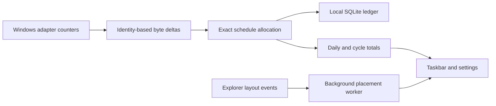

# NetPulse

**Your connection, your data plan, your taskbar.**

NetPulse is a small native Windows network monitor for people whose data plans do not fit a fixed schedule. See live upload/download speeds and today's totals on the taskbar, define your own peak/off-peak hours, and adjust cycle usage to match your provider. Your history stays on your computer.

Created by [Avishka Udara](https://github.com/avishka-Udara). Free software under [GNU GPLv3](LICENSE).

## What makes NetPulse different

- **Your plan, your rules:** overnight peak/off-peak windows, separate allowances, configurable monthly resets, and manual adjustments.
- **Compact visibility:** a transparent, customizable taskbar widget with live speeds and daily totals. A tray fallback keeps tracking available when space cannot be verified.
- **Resets without losing history:** reset today's display or the billing cycle independently while preserving the original traffic ledger.
- **Native and local:** C11, Win32/GDI, and SQLite. No embedded browser, background server, account, analytics, or cloud storage.
- **Visible capture gaps:** per-app history, daily budgets and forecasts with capture coverage, so unobserved time is distinguishable from recorded zero traffic.
- **Inspectable accounting:** integer byte counters, explicit adapter selection, regression tests, matching source archives, and documented measurement limits.

## Techniques behind it

| Area | Implementation |
| --- | --- |
| Measurement | Windows IP Helper 64-bit counters, identity-based adapter tracking, per-direction reset handling, and physical/default-route filtering |
| Time allocation | Exact, overflow-safe integer proportional allocation; the remainder stays in the final segment so bytes are conserved |
| Persistence | SQLite WAL, minute buckets, batched transactions, a bounded retry backlog, exact daily summary caches, and incremental totals |
| App insights | Optional ETW helper, heartbeat coverage intervals, recent-rate forecasts, and persistent alert cooldowns |
| Placement | Separate accessibility worker, Explorer-scoped layout events, one-second throttling, 15-second periodic fallback, conservative gap selection |
| Rendering | Reusable widget back buffer, cached fonts, native keyboard-accessible controls, and repositioning only when geometry changes |
| Privacy | Local files only; monitoring needs no outgoing request. Opening the developer link is an explicit user action |



## Per-app usage and daily budgets

**Applications** shows recorded TCP/UDP traffic by executable, with separate download/upload totals, a ranked list, and stacked charts. Choose a date and **Day** or **Month**, filter peak/off-peak traffic, and select an app to see its chart. Day charts show hourly buckets; month charts show tracking days. App history starts when capture is enabled; older adapter totals cannot be assigned to apps retroactively.

Choose **Enable app tracking** to start an optional elevated ETW collector. Windows may request administrator consent. The main UI retains its existing permissions; the helper only collects network-event metadata and sends byte totals through a restricted local pipe. It does not inspect packet contents or persist remote addresses. Stopping tracking drains available events, and the helper stops when the main process exits. Enable capture again after restarting NetPulse; no elevated service or automatic UAC prompt is installed.

**Daily budgets** lets you start each tracking day at midnight, at peak start, or at a custom HH:MM time. Set separate daily peak/off-peak allowances in decimal GB; 0 disables a budget. These budgets cover captured app traffic across all interfaces, excluding loopback, and are separate from your monthly adapter-based plan. VPN encapsulation and local transfers can affect this scope. Both directions count. Display resets do not replenish a budget or erase app history.

Forecasts use the recent five-minute average for the active time band, require at least 60 seconds of eligible capture, and project until the current band ends or the tracking day resets, whichever comes first. Idle time within that band remains in the average. A caution appears when the remaining allowance is projected to run out, and apps contributing at least 5% of the current rate are marked. These are warnings, not bandwidth caps or firewall rules. Missing capture, sleep, unknown processes, and changing workloads limit prediction accuracy; an event-loss indication disables the forecast for that capture session. Totals represent recorded traffic, not guaranteed complete billing usage.

Per-app totals remain separate from adapter counters to avoid adding the same traffic twice. App identity uses the executable path and validates process lifetime against event time; unresolved processes stay explicitly grouped. Retransmit and copy events are excluded. Browser tabs sharing an executable are grouped together. Paths and byte counts remain in the local database and its backups.

### Capture confidence and app details

The Applications page reports the percentage of the elapsed selected range observed by the collector. Paused periods, sleep and missing heartbeats remain **unknown usage**, not zero. History collected before coverage recording was introduced has unknown coverage. Event loss is highlighted; affected session forecasts are disabled. Coverage is collector availability, not proof that Windows or your provider measured every byte.

Select an application to see its daily/hourly trend, then choose **App details** for its executable path, selected-range total, today-so-far versus the previous full tracking day, and both days' capture coverage. Local executable icons are cached with a fixed limit; network paths and shell extensions are not loaded for decoration.

**Forecast** shows remaining allowance from captured usage, the recent average, the sustainable average until the current period ends, and a projected exhaustion time. These estimates include upload and download. They cannot account for other devices or traffic while capture was disabled.

### Optional alerts and history retention

In **Daily budgets**, choose **Quiet notifications** to enable Windows notifications at 75%, 90%, projected exhaustion, and budget reached. Alerts are off by default, request no sound, respect Windows quiet time, and run with the settings window closed. There is a 15-minute cooldown per time band. Higher-severity alerts supersede lower ones; each level is claimed once per tracking day and band, persisted across restart. Windows may suppress delivery, and suppressed alerts are not retried. Changing a cap does not reset that day's alert claims.

App history defaults to **Keep all history**. Optional 30/90/365-day retention keeps that many completed local tracking days plus the current day and permanently removes older app traffic and coverage after saving. It does not delete adapter totals, billing corrections or daily display resets. Back up history before reducing retention; switching back to unlimited cannot restore deleted records. Settings backups include this preference.

Completed tracking days are cached in SQLite in small batches. Monthly charts use whole-day summaries; partial-day and changed-boundary queries retain minute-level precision. Late arrivals invalidate and rebuild the affected cache. Retention reuses freed database pages; it does not force an expensive file-shrinking operation during monitoring.

## Install and run

**Version 1.4.0 is an unsigned Windows release candidate.** Windows 10/11 x64 is the current target. macOS/Linux are planned ports, not supported builds.

| Package | Purpose |
| --- | --- |
| `NetPulse-1.4.0-windows-x64-setup.exe` | Per-user installer, Start menu entry, upgrades and uninstall; no administrator rights required |
| `NetPulse-windows-x64.zip` | Portable app; extract before running |
| `NetPulse-1.4.0-source.zip` | Matching GPL source and build scripts |
| `SHA256SUMS.txt` | Package checksums |

Published binaries belong in [GitHub Releases](https://github.com/Avishka-Udara/NetPulse/releases). A source push does not itself create a release. Successful [CI runs](https://github.com/Avishka-Udara/NetPulse/actions) also produce artifacts.

Exit an older running copy before updating. Installer and portable builds normally use the same local data folder. Uninstall preserves usage history. Click the widget or tray icon for settings; right-click for the menu. The top-right **?** opens Help and About.

Enable **Taskbar > Start with Windows > On - at sign-in**, then save, to start quietly. Windows Startup Apps can independently disable registration. Re-enable startup after moving a portable executable.

```powershell
# Separate profile; the parent directory must exist.
.\NetPulse.exe --data-dir "C:\MyProfiles\NetPulse"
# Start quietly.
.\NetPulse.exe --background
# Save pending traffic and exit normally.
.\NetPulse.exe --quit
```

Only one instance runs at a time. A normal second launch opens the existing settings window.

## Customization

| Page | Controls |
| --- | --- |
| Overview | Daily upload/download, speeds, cycle totals, next reset, CSV export |
| Data plan | Typed HH:MM or half-hour presets, allowances, monthly reset day/time |
| Taskbar | Position preference, fine offset, adapter, Windows startup |
| Adjust usage | Provider-aligned cycle totals, cycle reset, daily-display reset |
| Appearance | Theme, background, width, text size, display details, and taskbar or tray-only mode |
| Applications | Day/month charts, app ranking/icons/details, coverage, period filters, optional collector, and forecast details |
| Daily budgets | Midnight/peak/custom day start, daily allowances, quiet alerts, and app-history retention |
| Manage | Export/restore settings, consistent history snapshots, open data folder, retry saving |

Both directions count toward the plan. Units are decimal: 1 GB = 1,000,000,000 bytes. K/M/G mean KB/MB/GB; `/s` identifies speed. Equal peak times mean all-day peak; overnight ranges work, zero allowance means unlimited, and reset days 29-31 clamp to shorter months. Scheduling follows Windows local time and daylight-saving rules.

Peak-hour changes affect future samples; history retains its original classification. Reset-schedule changes recompute the selected cycle. Daily-display resets persist until the next configured tracking day and do not change raw traffic or cycle adjustments. Ctrl-drag fine-tunes widget offset, subject to detected free space. Larger text can increase minimum width.

## Tracking, backup, and lower-overhead mode

Choose **Appearance > Run mode > Tray only**, then Save settings to stop embedded-widget work. A fresh tray-only launch does not initialize UI Automation; switching during a session pauses its worker and removes the widget. Network sampling and usage storage continue. Switching back resumes placement. Previously loaded system libraries can remain in memory until restart.

**Overview > Tracking details** shows the session start, monitored interface names, and whether today's display was reset. **Manage** exports saved settings or restores plan/appearance preferences; startup registration and traffic history remain unchanged. Missing/invalid imported fields use safe defaults; an unrecognized backup is rejected. Save or discard pending changes before backup/restore.

History snapshots use SQLite's backup API, including committed WAL data, and atomically replace the destination after a successful backup. For recovery, exit NetPulse first, preserve the old data folder, then restore a known-good database. Do not replace or delete a live database. Retry saving after fixing space/permission problems. There is no destructive automatic repair.

Mouse clicks suppress decorative focus boxes; keyboard navigation retains focus indicators. Unsaved changes are indicated and closing offers a discard confirmation. Validation feedback appears in the settings footer.

## Accuracy and compatibility limits

**Adapter traffic is not an ISP billing meter.** LAN transfers, protocol overhead, provider rounding, other devices behind the router, and VPN topology can cause differences. Automatic mode counts physical interfaces with default routes once each, excluding loopback/filter/endpoint interfaces. Select an adapter explicitly when needed.

Sampling occurs once per second. Allocation across time boundaries is proportional because this API does not provide packet timestamps. Counter resets, reconnects, sleep, and clock changes are handled conservatively. Traffic while NetPulse is closed cannot be recovered. A full persistence backlog can pause measurement; the UI reports storage problems.

The primary-taskbar integration depends on Explorer internals. Windows offers no supported general-purpose layout API for this embedded widget. No Explorer injection, patching, or replacement is used. Unsupported or unverified layouts fall back to the tray, including vertical taskbars. Scans can briefly lag taskbar animations.

The build is unsigned. Windows 10, mixed-DPI, sign-in, Explorer-menu recovery, and long-duration behavior need broader release QA. See [VALIDATION.md](VALIDATION.md) for evidence and outstanding checks.

## Resource use

Optional per-app tracking adds a helper process, ETW buffers, and bounded aggregation queues. The analytics view allocates its query buffers only when opened, releases them when settings close, and refreshes at most every five seconds. Earlier resource measurements below describe the older baseline, not this new feature.


NetPulse has no browser engine or managed-runtime dependency. Sampling is independent of the placement worker. Explorer-scoped event hooks avoid callbacks from unrelated apps, container elements skip unnecessary property queries, and rendering reuses its buffer and fonts. SQLite commits in batches rather than every sample.

The previous 1.1.0 background smoke sample measured **22.55 MiB working set**, **3.75 MiB private memory**, and **0.625% of one CPU core** over 30 seconds. Working set includes shared libraries; activity, drivers, layout, and open settings affect usage. These are observations, not guarantees. The original sub-10-MiB target is not met. Version 1.1.1 measured 0.364% of one CPU core, 22.36 MiB working set, and 3.34 MiB private memory in a 30-second run. The same-session baseline was also 0.365% CPU; sustained savings are not established. See [VALIDATION.md](VALIDATION.md).

## Local data and recovery

Settings and `netpulse.db` live in `%LOCALAPPDATA%\NetPulse`, unless `--data-dir` is supplied. Adjacent `config.ini` provides first-launch defaults. CSV includes raw traffic and cycle corrections; daily-display resets do not rewrite exported traffic.

SQLite commits every 60 seconds and on normal exit, settings changes, suspend, and shutdown notifications. Forced termination may lose the uncommitted interval. Failed commits retain samples for retry; the bounded backlog reserves two slots for a boundary-spanning sample. Close NetPulse before backing up its database, or retain the WAL/SHM files together with it.

## Build, test, and package

Prerequisites: MSVC's Desktop development with C++ workload, or LLVM-MinGW extracted under `tools/`; Python for supplementary SQL tests; Inno Setup 6.7+ for installers; PowerShell for packaging.

```powershell
.\build.bat
python tests/test_sql.py
.\build\test_startup.exe
.\build\test_network.exe --live
.\tools\package.ps1 -Iscc "C:\Program Files (x86)\Inno Setup 6\ISCC.exe"
```

The build runs core, database, network, settings, placement, and ETW event-decoding tests. The separate startup integration test redirects the registry inside its own process and never modifies the real Run entry. The live counter test requires an active adapter. SQLite 3.53.4 source is included; `tools/fetch-sqlite.ps1` restores the checksum-pinned amalgamation if needed. CI includes Windows tests/packaging and portable core/SQL checks on Linux; that job does not build a Linux desktop app.

| Source | Responsibility |
| --- | --- |
| `core.c` | Schedules, counter deltas, exact byte allocation |
| `network.c` | Windows counters and adapter selection |
| `db.c` | Ledger, transactions, corrections, daily resets, export |
| `taskbar.c`, `placement.h` | Background layout discovery and gap selection |
| `ui.c` | Widget rendering and native settings |
| `settings.c`, `startup.c`, `main.c` | Configuration, startup registration, lifecycle |

## Contribute and distribute

See [CONTRIBUTING.md](CONTRIBUTING.md), [RELEASE.md](RELEASE.md), and the [macOS/Linux roadmap](ROADMAP.md). Include Windows version, display scaling, reproduction steps, and expected behavior in issues. Do not upload usage databases or credentials.

NetPulse is **GPL-3.0-only**. Distribute matching source with binaries and preserve [third-party notices](THIRD_PARTY_NOTICES.md). SQLite is public domain; runtime notices are included separately.

## Release automation and extended checks

Pushing a tag matching the installer version (for example `v1.4.0`) runs tests and creates a **draft** GitHub release with installer, portable ZIP, corresponding source, checksums, and generated notes. It does not publish automatically or provide code signing. Review [QA.md](QA.md) before publishing.

For longer measurements, run `tools/measure-resources.ps1 -ProcessId <id> -Minutes 60 -OutputPath samples.csv`. The script only observes the selected NetPulse process. User-reported memory below 10 MB is plausible for a different memory metric/environment; it is not presented as a universal guarantee.
